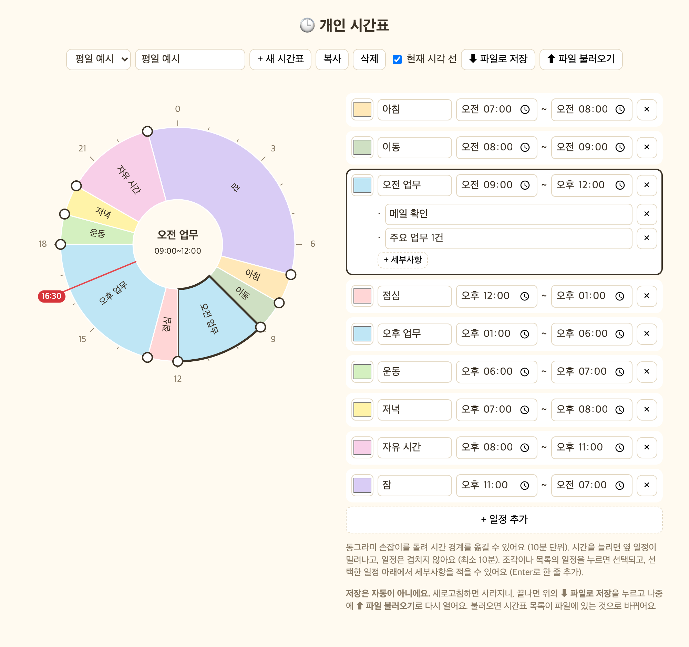

# time-planner

시간과 일정을 관리하는 작은 웹 앱 모음입니다. 하루를 어떻게 쓸지 계획하는 도구를 하나씩 만들어 이곳에 모아요.

- 설치, 서버, 계정 없이 브라우저에서 바로 열어 쓸 수 있어요 (앱마다 `index.html` 하나).
- 데이터는 내 PC의 파일(JSON)로 직접 저장하고 불러와요.
- 앱마다 폴더가 따로 있고, 사용법은 각 폴더의 README에 있어요.

## 앱 목록

| 앱 | 설명 | 열기 |
| --- | --- | --- |
| [circle-planner](circle-planner/) | 하루 24시간을 원 위에 나눠 그리는 개인 시간표 | <https://rosedskim.github.io/time-planner/circle-planner/> |

