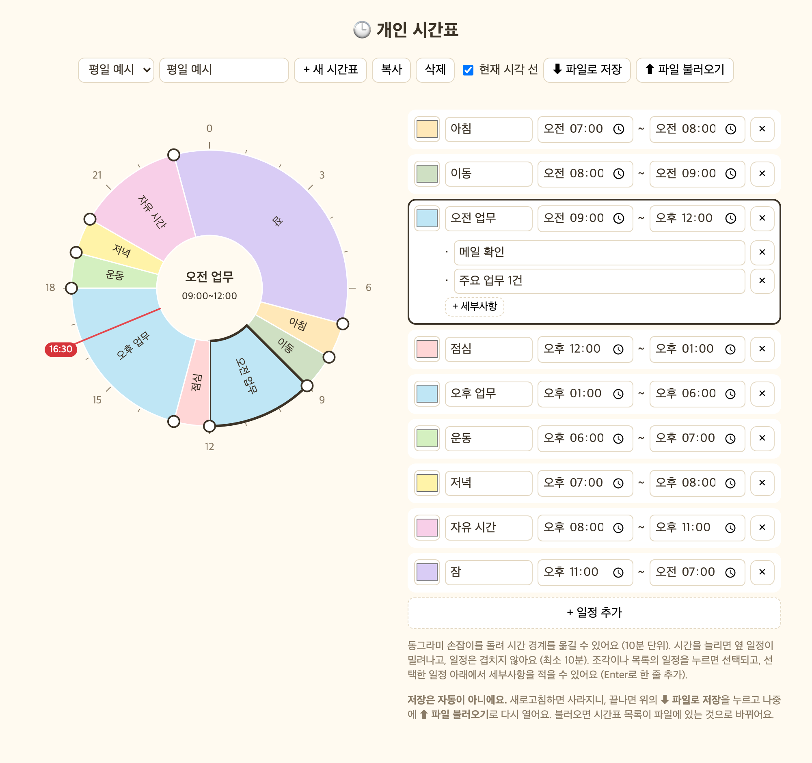

# 🕒 circle-planner (개인 시간표)

[time-planner](../README.md)의 원형 시간표 앱입니다. 어릴 때 그리던 방학 시간표처럼, **하루 24시간을 원 위에 나눠 그리는** 간단한 웹 앱입니다.
설치도 서버도 필요 없이 `index.html` 하나로 동작합니다.

## 웹에서 바로 쓰기

<https://rosedskim.github.io/time-planner/circle-planner/> 을 열면 설치 없이 바로 쓸 수 있어요. 웹에서 써도 데이터는 내 PC의 파일(JSON)로 저장하고 불러와요. 앱은 데이터를 어디로도 보내지 않고, 브라우저 저장소도 쓰지 않아요.



## 주요 기능

- **원형 24시간 시간표** — 0시가 위, 시계 방향. 지금 시각은 빨간 선으로 표시돼요.
- **일정이 겹치지 않아요** — 한 일정의 시간을 늘리면 옆 일정이 자동으로 밀려납니다. 옆 일정이 너무 짧아지면(10분 미만) 거부돼요.
- **10분 단위** — 드래그, 시간 입력, 최소 길이 모두 10분입니다.
- **손잡이 드래그** — 원 위의 동그라미를 돌려 시간 경계를 옮길 수 있어요.
- **자정을 넘기는 일정** — 예: 잠 `23:00 ~ 07:00`.
- **세부사항** — 일정마다 할 일을 여러 줄 적을 수 있어요 (예: 오전 업무 → 메일 확인, 주요 업무 1건).
- **시간표 여러 개** — 평일/주말처럼 여러 개를 만들고, 복사하고, 골라서 볼 수 있어요.
- **JSON 파일로 저장/불러오기** — 서버나 계정 없이 내 파일로 보관해요.

## 내 PC에서 직접 실행하기

방법 1. `index.html`을 더블클릭해서 브라우저(Chrome, Safari 등)로 엽니다.

방법 2. 터미널에서 이 폴더로 이동해 간단한 서버를 켭니다 (Python 필요).

```bash
python3 -m http.server 8000
```

그리고 브라우저에서 <http://localhost:8000> 을 엽니다.

## 사용법

1. **일정 만들기** — `+ 일정 추가`를 누르면 가장 넓은 빈 시간에 1시간짜리가 생겨요. 이름, 색, 시작/끝 시간을 목록에서 고칩니다.
2. **시간 조절** — 목록의 시간 칸을 고치거나, 원 위 손잡이를 드래그하세요.
3. **세부사항 적기** — 원의 조각이나 목록의 일정을 누르면 선택되고, `+ 세부사항`으로 줄을 추가해요. Enter를 누르면 다음 줄이 생겨요.
4. **시간표 관리** — 상단에서 시간표를 고르고, 이름을 바꾸고, `+ 새 시간표`(빈 시간표), `복사`, `삭제`를 쓸 수 있어요. 시간표가 하나뿐이면 삭제할 수 없어요.
5. **저장** — 끝나면 `⬇ 파일로 저장`을 누르세요. `timetables-날짜.json`이 브라우저의 다운로드 폴더에 저장됩니다.
6. **불러오기** — 다음에 `⬆ 파일 불러오기`로 그 파일을 고르면 이어서 쓸 수 있어요.

## ⚠️ 알아둘 점

- **저장은 자동이 아니에요.** 데이터는 브라우저 메모리에만 있어서 새로고침하거나 탭을 닫으면 사라집니다. 저장하지 않은 변경이 있으면 닫을 때 경고가 떠요.
- **불러오면 목록이 교체돼요.** 지금 화면의 시간표가 파일에 있는 시간표들로 바뀝니다. 저장하지 않은 변경이 있으면 먼저 물어봐요.
- 파일이 비었거나 형식이 맞지 않으면 "불러오기 실패"를 알려 주고 화면은 그대로 둡니다. 일부 시간표만 문제가 있으면 나머지만 불러와요.
- 일정 이름은 12자, 시간표 이름은 20자까지예요. 40분보다 짧은 일정은 원 위에 이름이 표시되지 않아요 (목록에서는 보여요).

## 예시 파일

[`example.json`](example.json)에 평일/주말 시간표 예시가 들어 있어요. `⬆ 파일 불러오기`로 열어 보세요.

## 파일 형식

```json
{
  "app": "timetable",
  "version": 1,
  "tables": [
    {
      "name": "평일 예시",
      "blocks": [
        {"name": "잠", "color": "#d9ccf5", "start": 1380, "end": 420, "details": []},
        {"name": "오전 업무", "color": "#bfe6f5", "start": 540, "end": 720, "details": ["메일 확인"]}
      ]
    }
  ]
}
```

- `start`, `end`는 하루 0시부터의 **분**(0~1439)이에요. `end`가 `start`보다 작으면 자정을 넘기는 일정입니다.
- `color`는 `#rrggbb` 형식이에요.
- 일정끼리 겹치는 시간표는 불러오지 않아요.
